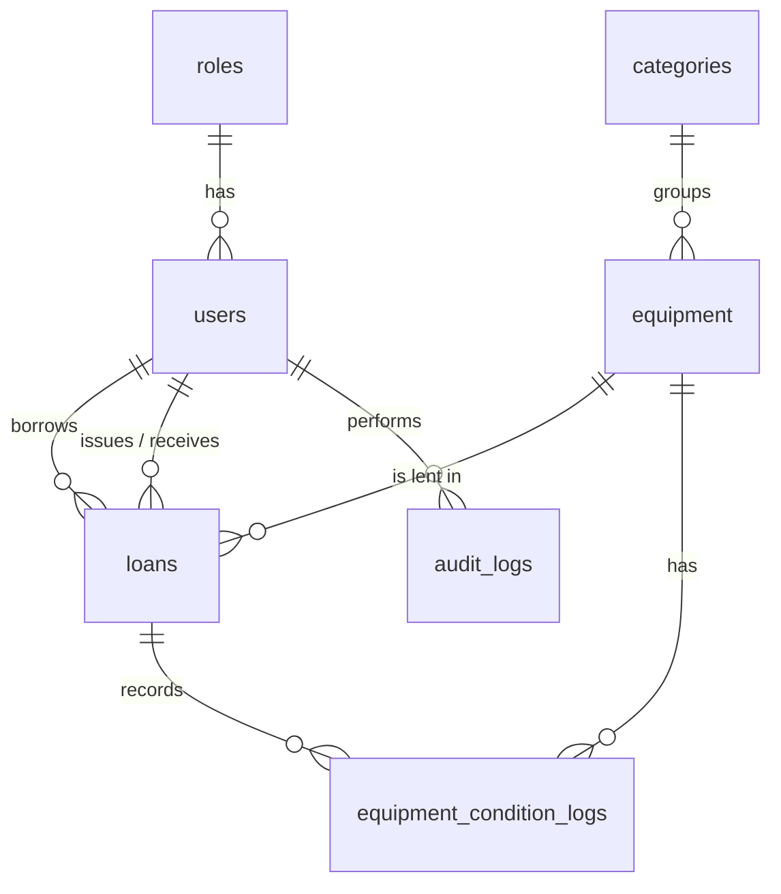

# University Equipment Lending System (UELS) — Backend

A PHP + MySQL REST API for managing the borrowing, returning and inventory of university-owned
equipment (power banks, chargers, keyboards, mice, printers, scanners, extension cords, projectors, …).

- **Backend:** PHP 8+ (plain PHP, no Composer needed), PDO
- **Database:** MySQL / MariaDB (XAMPP) — views, stored procedures, triggers, indexes, transactions
- **Auth:** PHP sessions + role-based access control (administrator, staff, student, faculty)
- **Front-end:** build it with HTML / CSS / JS / Bootstrap and call this API with `fetch(..., { credentials: 'include' })`

---

## 1. Setup in XAMPP + VS Code

1. Install [XAMPP](https://www.apachefriends.org/) (PHP 8.0+). Start **Apache** and **MySQL**.
2. Put this folder at `C:\xampp\htdocs\uels-backend` (or clone it there) and open it in VS Code.
3. **Create the database** — open <http://localhost/phpmyadmin> → **Import** → choose
   `database/uels_full.sql` → **Go**.
   (Or run the numbered files `01` → `05` one by one in the **SQL** tab.)
4. Copy the environment file:
   ```
   copy .env.example .env
   ```
   The defaults already match XAMPP (`root`, empty password, database `uels_db`).
5. Check it works: <http://localhost/uels-backend/api/health>
   → `{"success":true,"message":"OK","data":{"status":"ok",...}}`
6. Create the first administrator (works only once, while there are no users):
   ```
   POST http://localhost/uels-backend/api/setup
   { "id_number": "ADMIN-001", "first_name": "System", "last_name": "Admin",
     "email": "admin@university.edu", "password": "ChangeMe123!" }
   ```
   The easiest way: install the VS Code **REST Client** extension and open `docs/requests.http`.

> Re-running `01_schema.sql` / `uels_full.sql` **drops all tables** — use it only to reset a dev database.

---

## 2. Push to GitHub

```bash
cd uels-backend
git init
git add .
git commit -m "Initial commit: UELS backend (PHP + MySQL)"
git branch -M main
git remote add origin https://github.com/<your-username>/uels-backend.git
git push -u origin main
```
`.env` is git-ignored, so your database password is never uploaded. Teammates copy `.env.example` to `.env`.

---

## 3. Project structure

```
uels-backend/
├── database/
│   ├── 01_schema.sql        tables, PK/FK, constraints, indexes
│   ├── 02_views.sql         reporting views
│   ├── 03_procedures.sql    transactional stored procedures + status function
│   ├── 04_triggers.sql      automatic status / validation / condition logging
│   ├── 05_seed.sql          roles, categories, sample equipment
│   └── uels_full.sql        all of the above in one file (phpMyAdmin import)
├── public/
│   ├── index.php            front controller + route table (role access defined here)
│   └── .htaccess            pretty URLs
├── src/
│   ├── bootstrap.php        autoloader, .env, timezone
│   ├── Core/                Database, Router, Request, Response, Auth, Validator, Paginator, Audit, Env
│   └── Controllers/         Auth, User, Category, Equipment, Loan, Report
├── docs/requests.http       ready-made API calls for the VS Code REST Client
├── .env.example
└── README.md
```

---

## 4. Roles & permissions

| Capability                                   | Administrator | Staff | Student / Faculty |
|----------------------------------------------|:---:|:---:|:---:|
| Manage users (any role) / deactivate         | ✅ | borrowers only (no deactivate) | ❌ |
| Manage categories & equipment records        | ✅ | ❌ | ❌ |
| View equipment & availability                | ✅ | ✅ | ✅ (active items only) |
| Record walk-in borrowing, issue, return      | ✅ | ✅ | ❌ |
| Approve / reject requests, record condition  | ✅ | ✅ | ❌ |
| Request / cancel own equipment request       | ❌ | ❌ | ✅ |
| View own loans, due dates, history           | ✅ | ✅ | ✅ (own only) |
| View all transactions, overdue, reports      | ✅ | ✅ | ❌ |
| Audit logs                                   | ✅ | ❌ | ❌ |

---

## 5. API reference

Base URL: `http://localhost/uels-backend/api` — all bodies are JSON.
Success: `{ "success": true, "message": "...", "data": ..., "meta": {...} }`
Error: `{ "success": false, "message": "...", "errors": { "field": "..." } }`
List endpoints accept `page`, `per_page` (max 100), `q` (search), `sort` (`name` or `-name`).

### Auth
| Method | Endpoint | Access | Notes |
|---|---|---|---|
| POST | `/setup` | public | First administrator only (once) |
| POST | `/auth/login` | public | `{ login (email or ID number), password }` — locks 15 min after 5 failures |
| POST | `/auth/register` | public | Student / faculty self-registration (toggle with `ALLOW_SELF_REGISTRATION`) |
| POST | `/auth/logout` | any user | |
| GET | `/auth/me` | any user | Current user + role |
| POST | `/auth/change-password` | any user | `{ current_password, new_password }` |
| GET | `/dashboard` | any user | Staff: inventory/loan statistics. Borrowers: own loan counts |

### Users
| Method | Endpoint | Access |
|---|---|---|
| GET | `/users?q=&role=&status=` | admin, staff |
| POST | `/users` | admin, staff (staff: borrowers only) |
| GET / PUT | `/users/{id}` | admin, staff |
| DELETE | `/users/{id}` | admin (deactivates; blocked if items unreturned) |
| GET | `/users/{id}/loans` | staff, or the borrower themself — **borrowing history** |

### Categories & Equipment
| Method | Endpoint | Access |
|---|---|---|
| GET | `/categories` | any user |
| POST / PUT / DELETE | `/categories[/{id}]` | admin |
| GET | `/equipment?q=&category_id=&status=&condition=&available_only=1&include_inactive=1` | any user |
| GET | `/equipment/{id}` | any user (shows total / available / on-loan / damaged units) |
| POST / PUT / DELETE | `/equipment[/{id}]` | admin |
| GET | `/equipment/{id}/loans` | staff — borrowing history of an item |
| GET | `/equipment/{id}/condition-logs` | staff — condition before/after each loan |

Equipment `status` (`available` / `borrowed` / `damaged` / `unavailable`) is calculated automatically
by a trigger from the stock quantities — you never set it by hand.

### Loans
| Method | Endpoint | Access | Notes |
|---|---|---|---|
| GET | `/loans?status=&borrower_id=&equipment_id=&category_id=&q=&from=&to=` | any user | Borrowers only see their own. `status=overdue` is supported |
| GET | `/loans/overdue` | staff | |
| GET | `/loans/{id}` | any user | |
| POST | `/loans/request` | student, faculty | `{ equipment_id, quantity, due_date, purpose }` → status `pending` |
| POST | `/loans` | staff | Walk-in: `{ borrower_id, equipment_id, quantity, due_date, condition_before?, purpose? }` |
| POST | `/loans/{id}/issue` | staff | Approve + hand over `{ due_date?, condition_before? }` |
| POST | `/loans/{id}/reject` | staff | `{ remarks? }` |
| POST | `/loans/{id}/cancel` | borrower (own) / staff | Pending only |
| POST | `/loans/{id}/return` | staff | `{ condition_after?, remarks? }` — `damaged` units are removed from available stock |

Loan lifecycle: `pending → borrowed → returned` (or `pending → rejected / cancelled`).
`overdue` is calculated (`borrowed` and `due_date` earlier than today); it appears as `display_status` / `days_overdue`.

### Reports (staff, admin) — add `?format=csv` to download
`/reports/inventory`, `/reports/borrowing`, `/reports/returns`, `/reports/overdue`,
`/reports/damaged`, `/reports/transactions` — date-range reports accept `from` and `to` (`YYYY-MM-DD`).

Admin only: `GET /audit-logs?user_id=&action=`

---

## 6. Business rules enforced in the database

- A borrower with **overdue items cannot borrow** more equipment.
- Maximum **5 pending** requests per borrower; maximum loan period **30 days**.
- Cannot borrow more than the **available quantity**; the equipment row is locked
  (`SELECT … FOR UPDATE`) during issue/return so two staff can never lend the last unit twice.
- Returned items marked **damaged** go to `damaged_quantity`, not back to stock.
- Closed loans (returned / rejected / cancelled) cannot be reopened.
- Equipment with borrowing history is **deactivated**, never hard-deleted.

## 7. Advanced database features (for your project documentation)

| Feature | Where |
|---|---|
| Primary & foreign keys | every table, `01_schema.sql` |
| Normalization (3NF) | roles / users / categories / equipment / loans / condition logs split into separate tables |
| Constraints | `UNIQUE`, `NOT NULL`, `ENUM`, `CHECK` (quantities), FK `RESTRICT/SET NULL/CASCADE` |
| Views | `v_equipment_availability`, `v_loan_details`, `v_active_loans`, `v_overdue_loans`, `v_damaged_equipment`, `v_category_summary` |
| Stored procedures | `sp_request_loan`, `sp_issue_loan`, `sp_direct_borrow`, `sp_return_loan` |
| Stored function | `fn_equipment_status` |
| Triggers | auto equipment status, loan validation, legal status transitions, condition logging, delete protection |
| Indexing | name/asset-tag/category/status/due-date/borrower indexes on the hot query paths |
| Transaction management | `START TRANSACTION … COMMIT` with rollback handlers in each procedure; PHP `Database::transaction()` |

### Entity-relationship diagram


---

## 8. Security notes

- Passwords are hashed with `password_hash()` (bcrypt); all SQL uses prepared statements.
- Session cookie is `HttpOnly` + `SameSite=Lax`. Deactivated users lose access on their next request.
- Set `APP_DEBUG=false` and restrict `ALLOWED_ORIGIN` before deploying anywhere public, and serve over HTTPS.
- Change the sample administrator password immediately.
